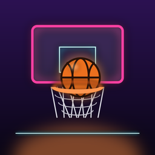
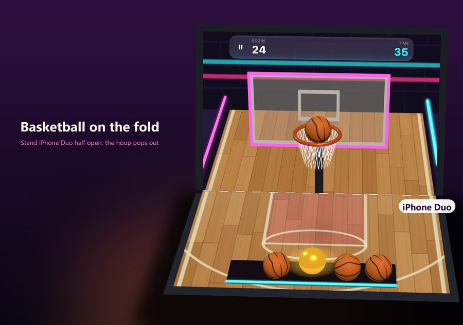
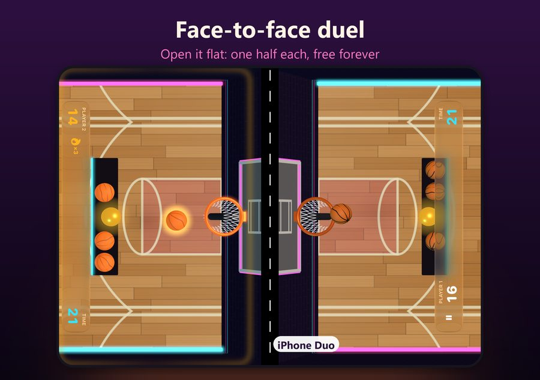
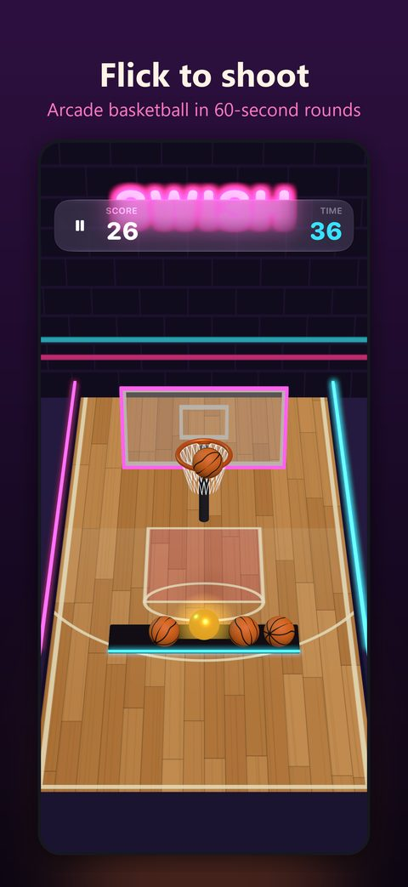
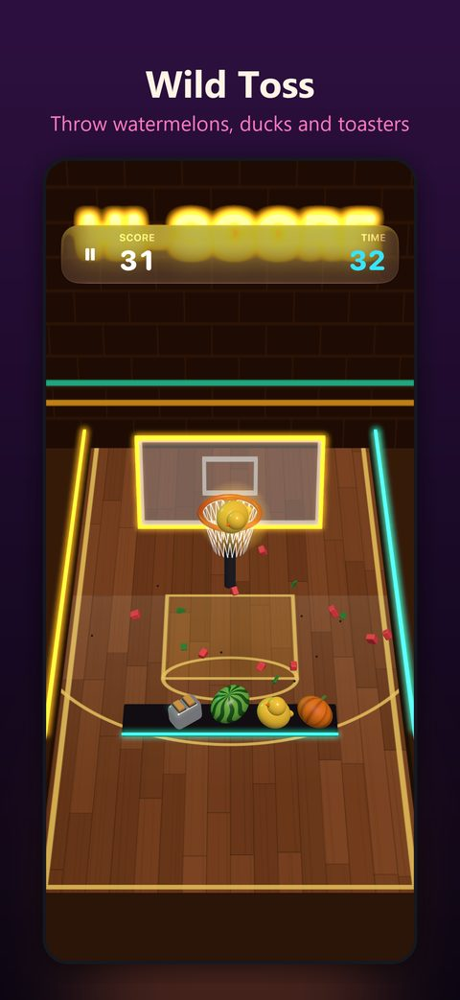
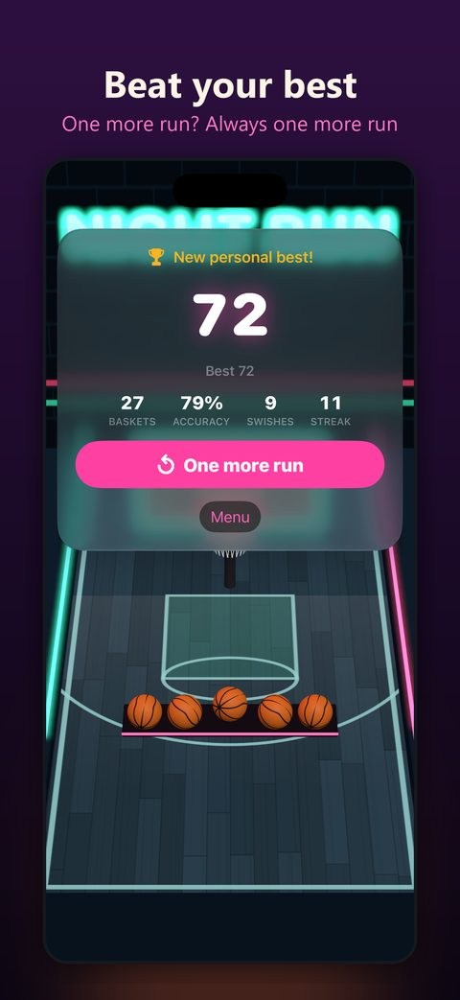

# Swish Alley: Arcade Basketball

Arcade basketball for iPhone, iPad and iPhone Duo. Flick the ball up to shoot; the speed and direction of your flick set the arc. 60-second rounds, a free face-to-face duel on one phone, and an optional head-tracked 3D hoop.

## Is there a basketball game for iPhone Duo?
Yes. Stand iPhone Duo half open: the upright half is the backboard, the lower half is the floor with the ball rack, and the rim hangs right above the fold. The game reads the live hinge angle and the real fold position from iOS, so the backboard stands upright and the floor lies flat at 90°, 110°, 130° or anything in between, and the ball's arc follows the real shape of the phone.

## Can two people play on one phone?
Open iPhone Duo flat between you, one half each (on any other iPhone or iPad the screen splits in the middle). Race at the same time or take turns. The duel is free.

## How does the 3D hoop work?
Optional head tracking: the front camera finds your eyes and each half of the display is drawn with an off-axis projection from that point, so the hoop seems to stand out of the phone. Frames are analysed on the device and never stored or sent. The game plays the same without it.

## Features
- One-flick shooting, aim help for near misses, the same feel on every device (flick speed is measured in real metres per second).
- On fire after three in a row, unstoppable after six, golden balls with a big hoop or double points, a moving hoop and double points in the last 10 seconds.
- Classic 60, Overtime, Drift, Duel (race or turns) and Practice, all free. Pro (one-time): three arenas, four balls and Wild Toss (watermelons, rubber ducks, toasters, pumpkins).
- Net swish, rim rattle, board thump and a haptic for every bounce; original instrumental music synthesized on the device.
- No account, no ads, no tracking, works offline.

## Development
Native SwiftUI + SceneKit, generated with XcodeGen. The iPhone Duo geometry (hinge angle → display planes, fold-aligned lane and interface) lives in `SwishAlley/Core/Layout.swift` and is unit-tested in `SwishAlleyTests/GeometryTests.swift`; the ball physics in `SwishAlley/Game/Lane.swift`. CI: `.github/workflows/ios-testflight.yml` (tests → TestFlight), `screenshots.yml` (simulator screenshots, including the iPhone Duo hinge sweep check).

MIT licence. Privacy: [PRIVACY.md](PRIVACY.md). iPhone and iPhone Duo are trademarks of Apple Inc.
